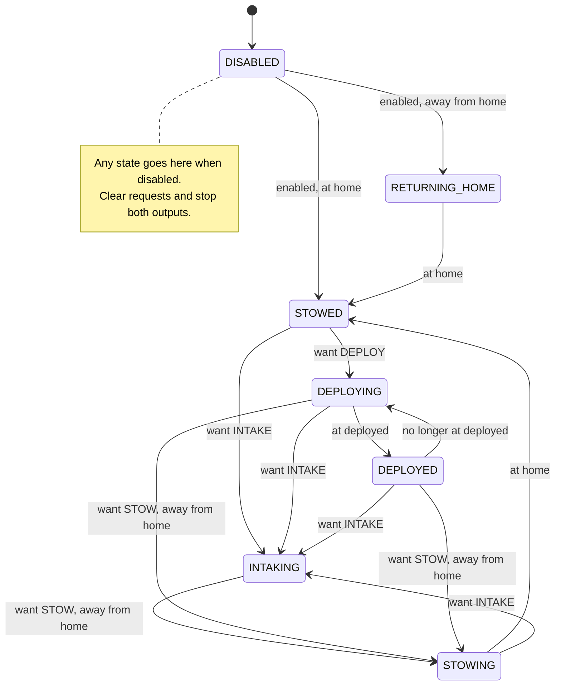

# State-machine practice: intake reference and robot conversion

Practice the same workflow we'll use during the season: ask questions, design the behavior, implement it on a branch, test in simulation, and request review.

## Read the reference

- [254's 2022 intake](https://github.com/Team254/FRC-2022-Public/blob/6a24236b37f0fcb75ceb9d5dec767be58ea903c0/src/main/java/com/team254/frc2022/subsystems/Intake.java): read `WantedState`, `SystemState`, `setWantedState`, `handleAll`, and the output switch in `onLoop`.
- [RTR intake example](../../src/main/java/frc/robot/subsystems/ground_intake/GroundIntakeSubsystem.java).
- [Simulation tests](../../src/test/java/frc/robot/subsystems/ground_intake/GroundIntakeSimulationTest.java).

This example adapts the request/state/output separation to RTR's existing WPILib and AdvantageKit IO structure. It does not import 254's scheduler or hardware classes. `WantedState` is the requested behavior; `SystemState` is the behavior being executed. A system state such as `INTAKING` describes commanded behavior, not proof that fuel is entering the robot.

## Intake design

Every cycle reads and logs measurements, resolves requests and transitions, writes outputs, and logs the wanted and system states. `setWantedState` only records a request. The existing `StateMachine.setIntakeState` maps old requests to the new API so controls and autos continue to work while the other subsystems await conversion.

This chart shows the forward-intake/stow path. The table below defines reverse and oscillate behavior too. A new wanted state is evaluated every cycle, including during movement.



| Wanted state | Condition / system state | Actuator target | Rollers |
| --- | --- | --- | --- |
| `STOW` | At home: `STOWED` | Home | Off |
| `STOW` | Returning from an out state: `STOWING` | Home | Forward until home |
| `STOW` | Startup, after zeroing, or from a home reverse: `RETURNING_HOME` | Home | Off |
| `DEPLOY` | Away: `DEPLOYING`; arrived: `DEPLOYED` | Deployed | Off |
| `INTAKE` | `INTAKING`, including during deployment | Deployed | Forward |
| `REVERSE_HOME` | Away: `HOMING_FOR_REVERSE`; arrived: `REVERSING_HOME` | Home | Off until home, then reverse |
| `REVERSE_DEPLOYED` | Away: `DEPLOYING_FOR_REVERSE`; arrived: `REVERSING_DEPLOYED` | Deployed | Off until deployed, then reverse |
| `OSCILLATE_OFF` | `OSCILLATING_OFF` | Midpoint | Off |
| `OSCILLATE_ON` | `OSCILLATING_ON` | Midpoint | Forward |
| Any, while disabled | `DISABLED`; wanted reset to `STOW` | Stop actuator | Off |
| Any, during driven zeroing | `ZEROING`; wanted reset to `STOW` | Owned by `ZeroingCommand` | Off |

Arrival means measured actuator position is within 0.5 inches of the named target. No transition depends on the previous IO target or the `isDeployed` flag. Reverse waits indefinitely if the mechanism never arrives; changing the request still cancels that wait. A timeout/fault policy is a design question for the team, not implemented in this example.

The existing shooting-push timer remains a request producer: while firing, request forward rollers if deployed, then request home after the existing teleop/auto delay. Moving this coordination out of the subsystem is part of the whole-robot design discussion.

## Behavior changes to review

- A single roller output replaces independent forward/reverse flags. Reversing can no longer leave forward active, and a cancelled wait cannot fire later.
- Home reverse waits for **home**. The previous code waited for deployed while commanding home.
- `OSCILLATE_ON` explicitly commands forward rollers. It no longer depends on the roller output left over from the previous state.
- Disable clears the request and stops the actuator and rollers. Re-enable returns home with rollers off. Driven zeroing owns the actuator and stops rollers.
- Forward intake still runs during deployment; retraction from an out state still pulls fuel inward until home. This differs from the initial simplified discussion example.
- The sim now honors actuator stop. Its existing position model and instantaneous roller velocity remain approximations; these tests validate sequencing, not physical tuning or fuel handling.

## Your assignment

Reimplement the intake yourself, then apply this design approach across the robot. Coordinate ownership so people don't overwrite each other's subsystem changes. Use the worked branch as a reference; build your implementation from the baseline rather than copying or cherry-picking the finished change.

Start from commit `6cc08309a97962e251b3e30d9e2cedc1f8cc02df`, the team branch before the worked example. Save any current work on your existing branch before switching.

```bash
git fetch origin
git switch -c training/YOUR-NAME-state-machines 6cc08309a97962e251b3e30d9e2cedc1f8cc02df
```

1. Read the references and describe wanted versus system state in your own words. Ask Brandon about behavior you can't determine from the code, especially reverse, cancellation, zeroing, and which requests should win.
2. Before implementing, open a draft PR against `STEMlyAndC3` with your intake chart, output table, and questions. Push your design first so there's something concrete to review.
3. Reimplement the intake. Keep changes small, commit as you go, and push updates. Include sim evidence and ask for review before moving on to the next subsystem.
4. Extend the approach across the robot: shooter/hood/kicker, indexer, turret, climber, intake coordination, and the top-level robot state machine. Review drive, vision, and LEDs too; explain where they need stateful behavior and where they only supply measurements or display status. Every subsystem needs a deliberate decision; don't add duplicate enums where they have no purpose.
5. Preserve controls, autonomous requests, homing, and existing IO boundaries. Put any intended behavior change in the PR. Define who owns outputs and how competing requests are resolved. Keep readiness queries free of state changes.
6. For each mechanism, deliver its chart, output table, transition conditions, implementation, and simulation evidence. Include normal completion, interruption, repeated requests, stalled/missing feedback, and disable/re-enable. Test whole-robot coordination after individual conversions.

Feel free to use AI as much as you want for design, code, tests, debugging, and explanations. You still need to explain your decisions and show that the result works. Ask Brandon questions throughout; don't wait until the PR is finished. When stuck, send what you expected, what happened, what you tried, and the relevant code or log.

## Run the reference in simulation

On macOS/Linux:

```bash
bash gradlew test --tests frc.robot.subsystems.ground_intake.GroundIntakeSimulationTest
bash gradlew build
bash gradlew simulateJava
```

On Windows use `gradlew.bat` in place of `bash gradlew`. You can also use WPILib's **Simulate Robot Code** command in VS Code and select the simulation GUI.

The automated tests run the actual intake subsystem and `GroundIntakeIOSim`, with HAL, simulated Driver Station enable/mode changes, and a stepped 20 ms clock. They exercise the old request API as well as the new state behavior. Read `build/reports/tests/test/index.html` for results.

In an interactive sim, inspect `GroundIntake/WantedState`, `GroundIntake/SystemState`, `GroundIntake/AtHome`, `GroundIntake/AtDeployed`, measured actuator position, and roller velocity in AdvantageScope. Exercise intake -> reverse -> off, retract while running, midpoint on/off, firing push, and disable while moving. State names alone are not evidence: compare them with outputs and measurements.

## Reference validation

Validated on 2026-11-09: `build` passed; all 15 intake simulation cases passed, with no failures or skipped cases. Full-robot `simulateJava` reached “Robot program startup complete” and ran the disabled loop before being stopped manually. It emitted a zero-component `Rotation2d` error during PathPlanner auto-chooser construction, a CTRE logger-directory message, and a startup loop overrun. Those originate outside the intake conversion; this startup check does not establish that autonomous paths work. No physical robot test was performed.
