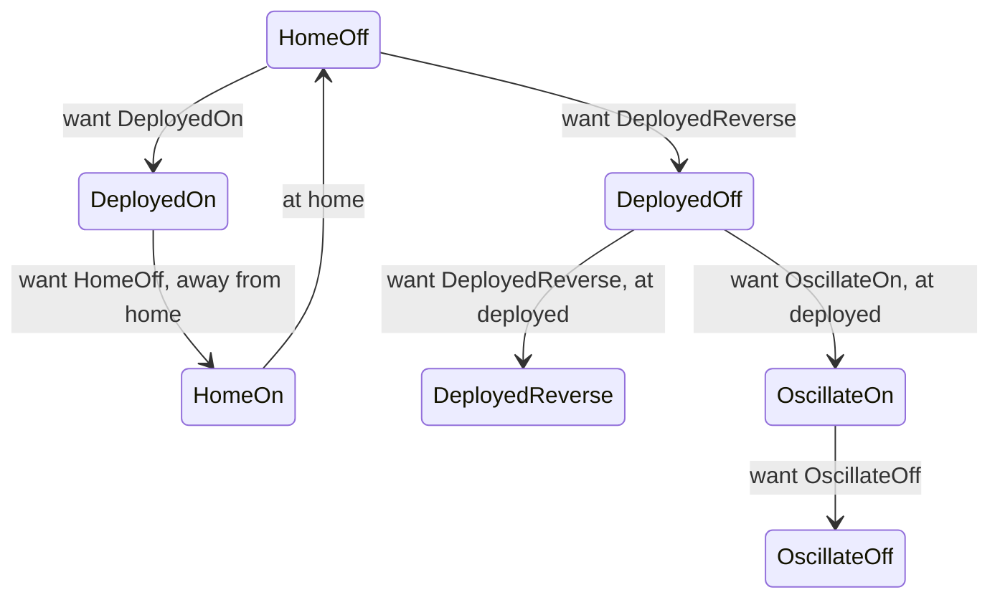

# State-machine practice

Reimplement the intake yourself, then apply the approach across the robot. Practice our in-season workflow: **design → branch → implement → simulate → review**.

Read [254’s intake](https://github.com/Team254/FRC-2022-Public/blob/6a24236b37f0fcb75ceb9d5dec767be58ea903c0/src/main/java/com/team254/frc2022/subsystems/Intake.java) and [our example](../../src/main/java/frc/robot/subsystems/ground_intake/GroundIntakeSubsystem.java). `WantedState` is the request; `SystemState` is the behavior being executed.

1. Create your own branch from the baseline below. Use the example as a reference; reimplement it yourself.
2. Push a state chart and output table. Open a draft PR against `STEMlyAndC3` with your design and questions before coding.
3. Implement the intake in small commits, test in sim, and ask for review.
4. Coordinate subsystem ownership and repeat across the entire robot, including the top-level state machine. Preserve controls, autos, homing, and IO boundaries; explain intentional behavior changes in your PR.

**Ask Brandon questions throughout.** When stuck, send what you expected, what happened, and what you tried. **Feel free to use AI as much as you want.** Be able to explain your implementation and demonstrate it working.

<details>
<summary>Git setup</summary>

Save your current work before switching. Start from the commit before the example:

```bash
git fetch origin
git switch -c training/YOUR-NAME-state-machines 6cc08309a97962e251b3e30d9e2cedc1f8cc02df
```

Commit and push your design, then implementation updates. Request review before moving to the next subsystem.

</details>

<details>
<summary>Intake chart and outputs</summary>

Each cycle: read measurements → decide state → apply outputs → log. Setters only record requests. Existing controls and autos use a compatibility mapping in `StateMachine.setIntakeState`.

Both enums use C3's seven request names. System states describe outputs, not proof of arrival: `DeployedOff` can mean moving outward with rollers off. `HomeOn` represents C3's forward rollers during retraction; `OscillateReverse` represents its retained reverse action.



This chart shows selected transitions; new requests are evaluated every cycle.

| Wanted state | Action |
| --- | --- |
| `HomeOff` | Retract; run forward when returning from out, then stop at home. |
| `HomeReverse` | Retract; reverse once home. |
| `DeployedOff` | Deploy; stop rollers. |
| `DeployedOn` | Deploy; start forward rollers immediately. |
| `DeployedReverse` | Deploy; reverse once deployed. |
| `OscillateOff` | Move to midpoint; stop rollers. |
| `OscillateOn` | Move to midpoint; start forward if deployed, otherwise retain the previous roller action. |

Arrival means within 0.5 inches of the named target. Reverse waits until arrival or a new request; no timeout is implemented. C3's shooting-push sequence and teleop/auto timing are retained. `Disabled` stops outputs and clears requests; `Zeroing` gives the actuator to the zeroing command.

</details>

<details>
<summary>Simulation commands and checks</summary>

```bash
bash gradlew test --tests frc.robot.subsystems.ground_intake.GroundIntakeSimulationTest
bash gradlew build
bash gradlew simulateJava
```

On Windows, replace `bash gradlew` with `gradlew.bat`. See the [simulation tests](../../src/test/java/frc/robot/subsystems/ground_intake/GroundIntakeSimulationTest.java) and `build/reports/tests/test/index.html`.

Test normal completion, interrupted/repeated requests, reversal, stalled feedback, zeroing, shooting push, and disable/re-enable. Compare wanted/system states with measured position and roller velocity in AdvantageScope. Test whole-robot coordination after individual conversions.

Build and all 19 sim cases passed on 2026-11-09. The earlier full-robot startup check completed, with a PathPlanner rotation error during auto loading, a CTRE logger-directory message, and a startup loop overrun. No hardware test; sim validates sequencing, not physical tuning or fuel handling.

</details>

<details>
<summary>Behavior changes in the example</summary>

- One roller output replaces conflicting forward/reverse flags and pending waiters.
- Home reverse waits for home, fixing C3’s deployed-position check. Reverse requests use measured arrival instead of the previous request’s position name.
- Disable clears requests and stops outputs; re-enable returns home with rollers off. Driven zeroing owns the actuator.
- C3 names, action helpers, forward deployment, retraction rollers, and conditional midpoint-on behavior are retained.
- Arrival checks use measured position against named targets. Sim now honors actuator stop.

</details>
