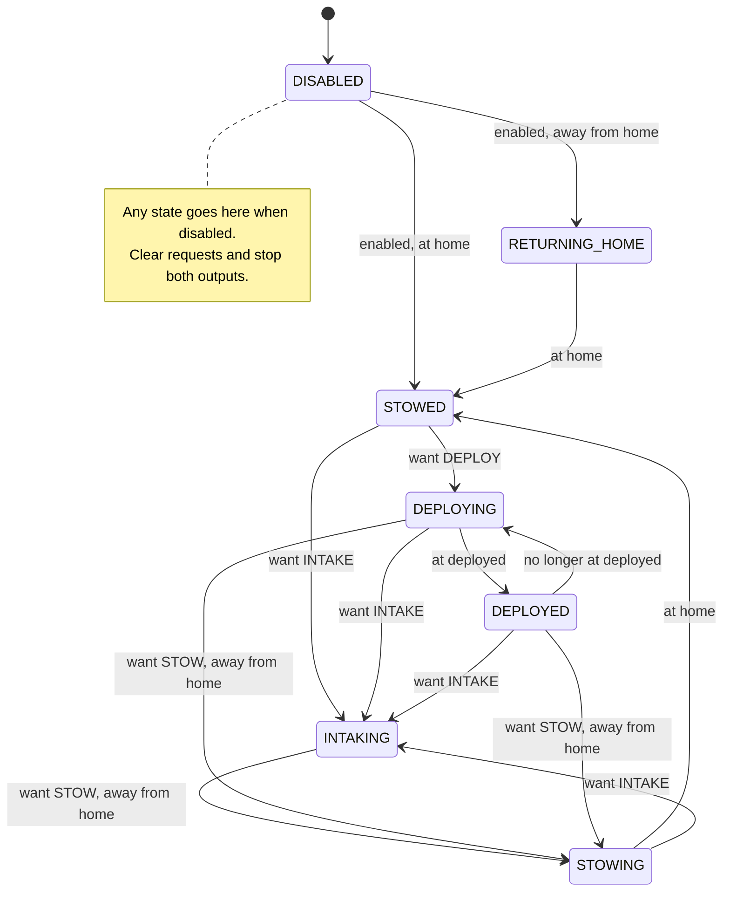

# State-machine practice

Reimplement the intake yourself, then apply the approach across the robot. Practice our in-season workflow: **design → branch → implement → simulate → review**.

Read [254’s intake](https://github.com/Team254/FRC-2022-Public/blob/6a24236b37f0fcb75ceb9d5dec767be58ea903c0/src/main/java/com/team254/frc2022/subsystems/Intake.java) and [our example](../../src/main/java/frc/robot/subsystems/ground_intake/GroundIntakeSubsystem.java). `WantedState` is the request; `SystemState` is the behavior being executed.

1. Create your own branch from the baseline below. Use the example as a reference; reimplement it yourself.
2. Push a state chart and output table. Open a draft PR against `STEMlyAndC3` with your design and questions before coding.
3. Implement the intake in small commits, test in sim, and ask for review.
4. Coordinate subsystem ownership and repeat across the entire robot, including the top-level state machine. Preserve controls, autos, homing, and IO boundaries; explain intentional behavior changes in your PR.

**Ask Brandon questions throughout.** When stuck, send what you expected, what happened, and what you tried. **Feel free to use AI as much as you want.** Be able to explain your implementation and demonstrate it working.

<details>
<summary>Git setup</summary>

Save your current work before switching. Start from the commit before the example:

```bash
git fetch origin
git switch -c training/YOUR-NAME-state-machines 6cc08309a97962e251b3e30d9e2cedc1f8cc02df
```

Commit and push your design, then implementation updates. Request review before moving to the next subsystem.

</details>

<details>
<summary>Intake chart and outputs</summary>

Each cycle: read measurements → decide state → apply outputs → log. Setters only record requests. Existing controls and autos use a compatibility mapping in `StateMachine.setIntakeState`.

The chart covers forward intake/stow; the table includes reverse and oscillate. New requests are evaluated every cycle, including during movement.



| Wanted state | Condition / system state | Actuator target | Rollers |
| --- | --- | --- | --- |
| `STOW` | At home: `STOWED` | Home | Off |
| `STOW` | Returning from an out state: `STOWING` | Home | Forward until home |
| `STOW` | Startup, after zeroing, or from a home reverse: `RETURNING_HOME` | Home | Off |
| `DEPLOY` | Away: `DEPLOYING`; arrived: `DEPLOYED` | Deployed | Off |
| `INTAKE` | `INTAKING`, including during deployment | Deployed | Forward |
| `REVERSE_HOME` | Away: `HOMING_FOR_REVERSE`; arrived: `REVERSING_HOME` | Home | Off until home, then reverse |
| `REVERSE_DEPLOYED` | Away: `DEPLOYING_FOR_REVERSE`; arrived: `REVERSING_DEPLOYED` | Deployed | Off until deployed, then reverse |
| `OSCILLATE_OFF` | `OSCILLATING_OFF` | Midpoint | Off |
| `OSCILLATE_ON` | `OSCILLATING_ON` | Midpoint | Forward |
| Any, while disabled | `DISABLED`; wanted reset to `STOW` | Stop actuator | Off |
| Any, during driven zeroing | `ZEROING`; wanted reset to `STOW` | Owned by `ZeroingCommand` | Off |

Arrival means within 0.5 inches of the named target. Reverse waits until arrival or a new request; no timeout is implemented. The existing shooting-push timer still produces intake/stow requests.

</details>

<details>
<summary>Simulation commands and checks</summary>

```bash
bash gradlew test --tests frc.robot.subsystems.ground_intake.GroundIntakeSimulationTest
bash gradlew build
bash gradlew simulateJava
```

On Windows, replace `bash gradlew` with `gradlew.bat`. See the [simulation tests](../../src/test/java/frc/robot/subsystems/ground_intake/GroundIntakeSimulationTest.java) and `build/reports/tests/test/index.html`.

Test normal completion, interrupted/repeated requests, reversal, stalled feedback, zeroing, shooting push, and disable/re-enable. Compare wanted/system states with measured position and roller velocity in AdvantageScope. Test whole-robot coordination after individual conversions.

Build and all 15 sim cases passed on 2026-11-09. Full-robot sim started, with a PathPlanner rotation error during auto loading, a CTRE logger-directory message, and a startup loop overrun. No hardware test; sim validates sequencing, not physical tuning or fuel handling.

</details>

<details>
<summary>Behavior changes in the example</summary>

- One roller output replaces conflicting forward/reverse flags and pending waiters.
- Home reverse waits for home; midpoint-on explicitly runs forward.
- Disable clears requests and stops outputs; re-enable returns home with rollers off. Driven zeroing owns the actuator.
- Forward intake still runs during deployment; stowing from an out state runs forward until home.
- Arrival checks use measured position against named targets. Sim now honors actuator stop.

</details>
